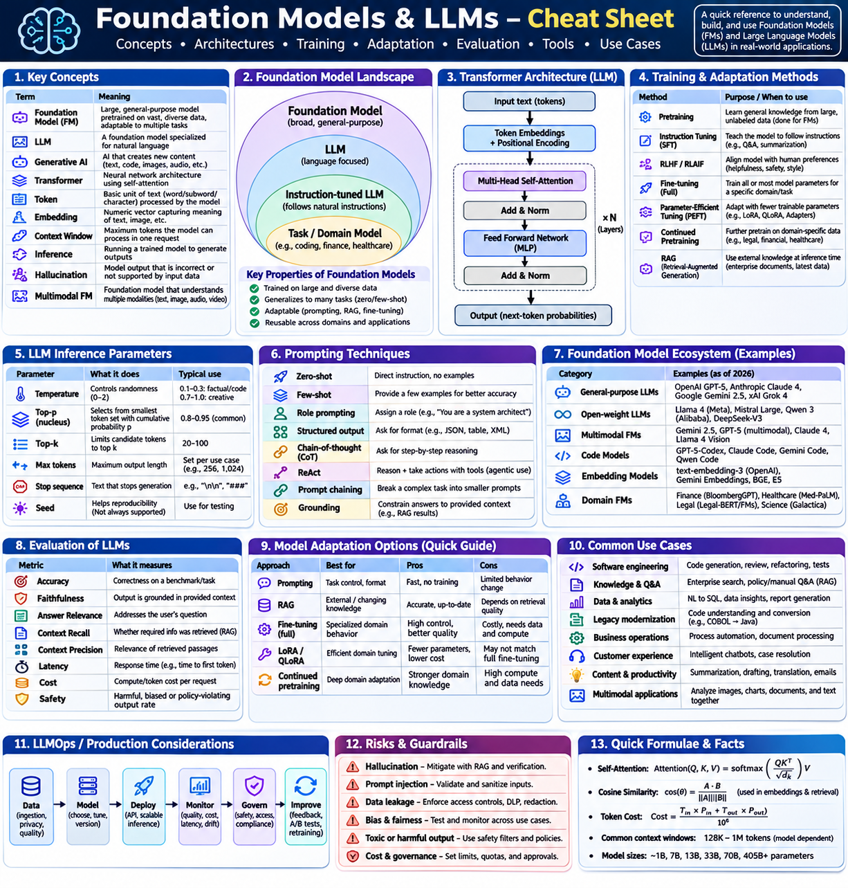
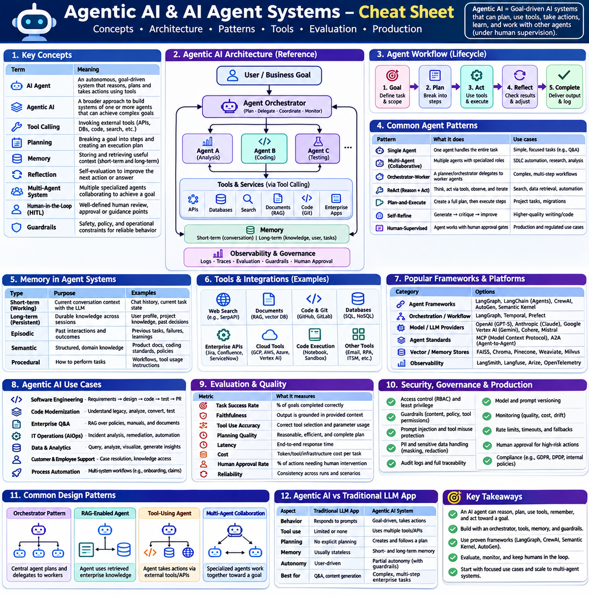
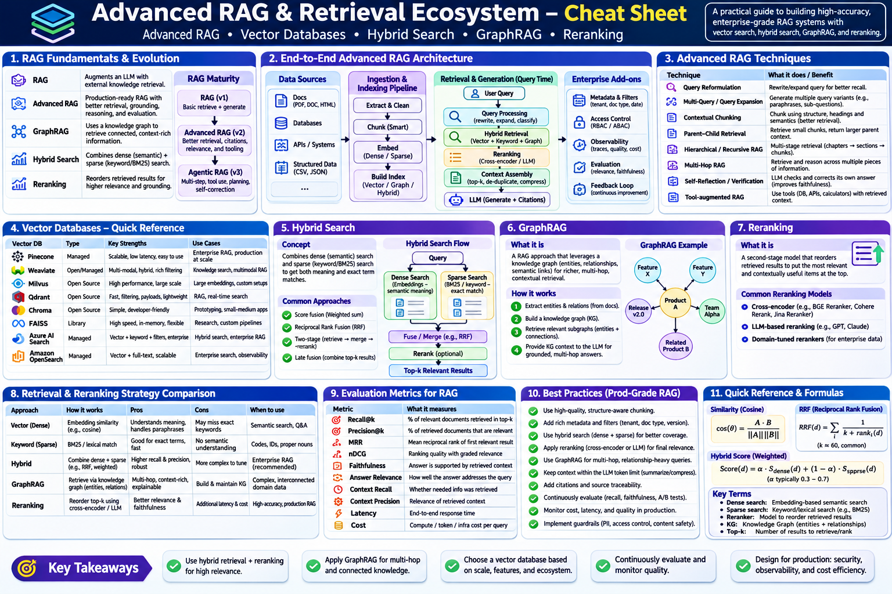

# Latest Topics to Track

## Foundation Models & LLM

## Agentic AI

## RAG n Knowledge Systems

## AI Coding n SDLC

## AI Engineering n LLM Ops

## Model Context Protocol

## Multimodal AI

## Reasoning Models

## SLM

## Fine-tuning n Customization

## AI Security n Governance

## AI Infra

## Open Source AI Ecosystem

## Robotics n Physical AI

## AI Research Frontiers
