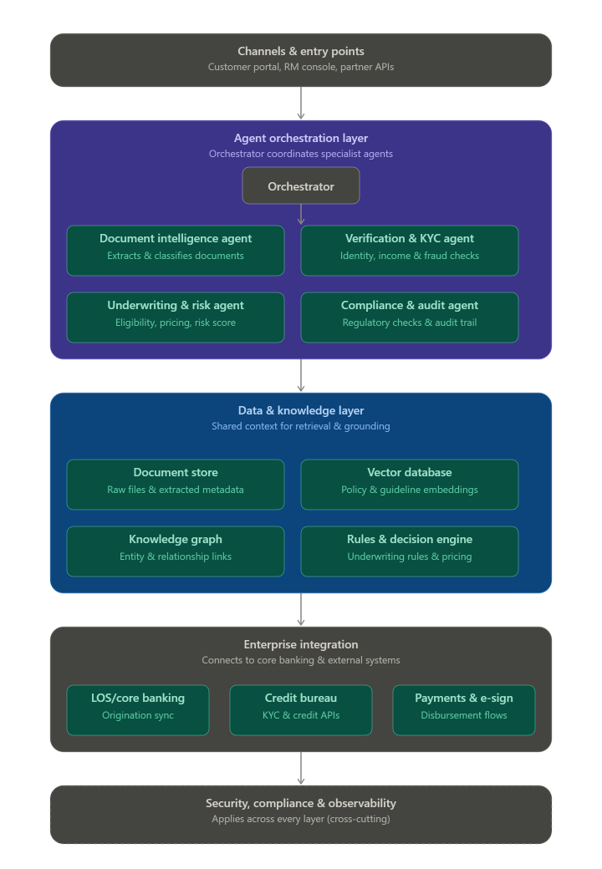

# Mortgages

## Topics

- Architecture
- AI Skillset
- Project Plan
- 
--------------------------------------------------------------------------------------------------------------------------------------------------------------------------------------------
### Architecture
    ## Diagram
         

    That's the architecture — five layers, top to bottom: channels feed an orchestrator that delegates to four specialist agents, backed by a shared data & knowledge layer (document store, vector DB, knowledge graph, rules engine), wired into your core banking/LOS and external APIs, with security and compliance wrapping everything as a cross-cutting concern.
    A few design notes worth calling out:
    •	The orchestrator pattern (vs. a single monolithic agent) matters here because mortgage onboarding has genuinely distinct sub-tasks — document extraction, identity/fraud checks, underwriting math, and regulatory compliance each benefit from focused prompts, different tools, and independent evaluation/monitoring.
    •	The knowledge graph is optional but valuable if you want to model relationships (co-borrowers, property liens, employer verification chains) that a vector DB alone can't capture well — similar to the graph layer in your RAG platform work.
    •	Human-in-the-loop checkpoints aren't drawn explicitly but should sit inside the underwriting and compliance agents — auto-approve within policy bounds, escalate edge cases.
    Now let me put together a detailed project plan as a document you can share with stakeholders.The plan covers the phased build (PoC → pilot in shadow mode → compliance hardening → scaled rollout), team composition, and the key risk that trips up projects like this — over-automating before compliance sign-off catches up.
    Given the RAG/knowledge-graph work you've already built (Pinecone, Neo4j, hybrid retrieval), you're in a good position to reuse a lot of that for the data & knowledge layer here rather than building it from scratch — the policy/guideline vector DB and knowledge graph patterns should transfer almost directly.
    A couple of things worth deciding early, if you want to dig into either:
    •	Whether to run this as build-vs-buy (custom LangGraph-style orchestration vs. a vendor agent platform, given you're in a bank with existing vendor relationships)
    •	What "shadow mode" success criteria should be before you're allowed to flip on any auto-approval, since that's usually the hardest internal sell to compliance/risk

### AI Skillset
        Here's the skill breakdown, organized by architecture layer so you can see exactly where each capability plugs in.
        Core agentic AI / LLM engineering
        •	Agent orchestration frameworks (LangGraph, AutoGen, CrewAI, or a custom state-machine approach) — needed for the         orchestrator and inter-agent handoffs
        •	Prompt engineering and structured output design (function calling, tool use, JSON schema enforcement) — every agent depends on this
        •	Multi-agent system design — task decomposition, state management, failure handling, retry/escalation logic
        •	LLM evaluation — building eval harnesses, golden datasets, accuracy/hallucination benchmarking (you'll need this before any auto-approval goes live)
        Document AI / extraction
        •	OCR and document layout understanding (for scanned pay stubs, tax forms, bank statements)
        •	Document classification and information extraction (fine-tuning or prompting for structured field extraction)
        •	Handling low-confidence extraction gracefully — confidence scoring, fallback-to-human design
        Retrieval & knowledge systems
        •	RAG pipeline design — embedding models, hybrid retrieval (dense + BM25), reranking. You already have this depth from your enterprise knowledge platform work
        •	Vector database operations (Pinecone or equivalent) — indexing policy/guideline documents, keeping them current
        •	Knowledge graph modeling (Neo4j, Cypher) — only needed if you pursue the relationship-based checks (co-borrowers, employer chains); this is your existing strength too
        Risk, underwriting & rules
        •	Rules engine design — encoding lending policy as executable, auditable logic rather than opaque LLM judgment
        •	Applied ML for risk scoring (if you want the underwriting agent to go beyond rules into predictive risk models) — credit risk modeling experience is valuable here
        •	Explainability techniques (SHAP, rationale generation) — regulators will want to know why an agent made a call
        Compliance & responsible AI
        •	Fair lending / regulatory domain knowledge (ECOA-equivalent, disclosure timing rules) — this is as much a compliance/legal skill as an AI one, but the AI team needs enough fluency to encode it correctly
        •	AI governance and audit trail design — logging decisions with evidence, versioning prompts/models, drift detection
        •	Bias testing for automated decisions — statistical parity checks across protected classes
        Platform & integration engineering
        •	API integration with legacy systems (LOS, core banking, credit bureaus) — often the actual bottleneck, less an "AI skill" than solid backend engineering
        •	Streaming/async architecture (FastAPI or similar) for agent pipelines that need to run concurrently and stream status back to users
        •	MLOps/LLMOps — model versioning, deployment, monitoring, cost/latency tracking in production
        Security
        •	PII handling, encryption, data masking for sensitive financial/identity documents flowing through LLM calls
        •	Prompt injection defense — critical once documents (potentially attacker-influenced) become agent input
        If it's useful, I can map these skill sets against the four phases in the project plan — some (document AI, core orchestration) are needed from Phase 1, while others (fairness testing, drift monitoring) don't matter until Phase 3.

### Project Plan
        Here's the mapping — when each skill set actually becomes load-bearing versus when it can wait.
        Phase 0 — Discovery & scoping
        •	AI governance/audit trail design (to know what evidence trail regulators will expect before you build anything)
        •	Regulatory/compliance domain fluency (to scope what "compliant automation" even means here)
        •	Enough platform engineering to inventory existing systems and API access constraints
        Phase 1 — Foundation & PoC (document intelligence agent)
        •	OCR and document layout understanding
        •	Document classification and structured extraction
        •	Confidence scoring / fallback-to-human design
        •	RAG pipeline design + vector DB operations (to stand up the policy/guideline knowledge base)
        •	LLM evaluation (build the eval harness now — you'll need it for every phase after this)
        •	Basic agent orchestration (thin orchestrator sequencing intake → extraction → validation)
        Phase 2 — Pilot (verification, underwriting agents, shadow mode)
        •	Full multi-agent orchestration — task decomposition, state handoffs between agents, escalation logic
        •	API integration with credit bureau and core banking (sandbox environments)
        •	Rules engine design (encoding lending policy as auditable logic)
        •	Applied risk/credit scoring, if you want the underwriting agent to do more than rules lookup
        •	Streaming/async architecture for concurrent agent pipelines
        •	Explainability techniques — this is when loan officers start needing to trust and verify agent recommendations
        Phase 3 — Compliance hardening & controlled rollout
        •	Fair lending domain knowledge and bias testing (statistical parity checks) — this is the hard gate before any auto-approval
        •	Prompt injection defense — real applicant-uploaded documents are now real attack surface
        •	PII handling, encryption, data masking — full security review happens here
        •	MLOps/LLMOps — versioning, deployment pipelines, drift detection, monitoring dashboards
        •	Knowledge graph modeling — only pull this in if Phase 2 pilot data actually shows relationship-based checks add value
        Phase 4 — Scale & continuous improvement
        •	Drift monitoring and continuous eval (ongoing, not a one-time build)
        •	MLOps maturity — this is where cost/latency tracking and threshold tuning become a full-time function rather than a project task
        •	Everything above, but now as steady-state operational skill rather than build skill
        A practical read on team sizing: Phases 0–1 can run with a small team heavy on RAG/document-AI/eval skills — which overlaps a lot with what you've already built. Phase 2 is where you need to actually add credit-risk and legacy-integration expertise. Phase 3 is where compliance/fair-lending specialists become non-negotiable — that's usually the phase people under-resource, and it's the one most likely to stall a rollout if it's thin.

### AI Arch Deep Dive
        Let's go deep into the actual AI architecture — model choices, retrieval design, agent reasoning patterns, and evaluation. This maps closely to the stack you've already built for your enterprise RAG platform, so I'll flag where it reuses directly.
        1. Model selection per agent
        Not every agent needs the same model — mixing tiers controls cost and latency:
        Agent	Task shape	Model tier rationale
        Document intelligence	High-volume, structured extraction	Smaller/faster model (e.g. Haiku-class) fine for most docs; escalate to a stronger model only on low-confidence or messy scans
        Verification & KYC	Cross-referencing, anomaly detection	Mid-tier model; mostly deterministic logic + LLM for reasoning over inconsistencies
        Underwriting & risk	Multi-factor reasoning, policy application	Strongest available model (e.g. Sonnet/Opus-class) — this is where reasoning quality directly affects loan decisions
        Compliance & audit	Precise rule-checking, low tolerance for error	Strongest model + heavy grounding in retrieved policy text, minimal free reasoning
        Orchestrator	Routing/planning, not domain judgment	Lightweight model — its job is control flow, not deep reasoning
        2. Document extraction pipeline (technical detail)
        This is usually a three-stage pipeline, not a single LLM call:
        •	Stage 1 — OCR/layout: A dedicated OCR engine (AWS Textract, Azure Document Intelligence, or open-source like Donut/LayoutLM) extracts raw text + bounding boxes. Don't ask an LLM to "read" a scanned image cold — layout-aware OCR is more reliable and cheaper.
        •	Stage 2 — Classification: A lightweight classifier (can be LLM-based with few-shot prompting, or a fine-tuned smaller model) tags the document type (W-2, pay stub, bank statement, ID).
        •	Stage 3 — Structured extraction: LLM call constrained to a strict JSON schema (tool-use/function-calling, not free text) per document type. Each field carries a confidence score — either from the model's own calibration or from a secondary verification pass (e.g., cross-checking extracted numbers against OCR bounding box confidence).
        Key design decision: schema-constrained output everywhere. Never let an agent return free text for anything downstream systems will parse — every agent-to-agent and agent-to-system handoff should be a validated JSON contract.
        3. RAG layer (you've already built most of this)
        •	Embedding model: text-embedding-3-large or similar for policy/guideline documents — same choice you made on your knowledge platform
        •	Chunking strategy: Policy documents chunk differently than documents you've handled before — mortgage guidelines have deeply nested conditional logic ("if LTV > 80% AND credit score < 680, then..."), so naive fixed-size chunking loses the conditional structure. Consider chunking by rule/clause boundary with metadata tagging (product type, effective date, jurisdiction) rather than pure token-count chunking.
        •	Hybrid retrieval: dense + BM25/RRF, same as your existing pipeline — sparse retrieval matters more here than in general knowledge RAG because underwriters search by exact terms (specific ratio names, program codes).
        •	Reranking: Cohere rerank or similar — important because policy retrieval needs high precision; a wrong policy clause surfacing in context can directly cause a bad underwriting decision.
        •	Freshness: Policy documents change (rate sheets, program eligibility) — you need an incremental sync pipeline (you've built this for Confluence already) with versioning, so the compliance agent can prove which policy version was active when a decision was made.
        4. Agent reasoning pattern
        For underwriting and compliance specifically, use a ReAct-style pattern with explicit tool calls, not open-ended chain-of-thought:
        1.	Agent retrieves relevant policy chunks (grounded, not memorized)
        2.	Agent calls a deterministic calculation tool for DTI/LTV (never let the LLM do the arithmetic itself — wrap it in a function tool)
        3.	Agent compares computed values against retrieved policy thresholds
        4.	Agent produces a structured decision object: {decision, confidence, reasoning, cited_policy_ids, flags}
        This keeps the "why" auditable — the compliance agent isn't asking the LLM to be trustworthy, it's asking the LLM to correctly cite and apply retrieved, versioned policy text plus deterministic math.
        5. Knowledge graph use (if you build it)
        Best applied to relationship-based fraud/risk signals a vector DB can't catch: shared employer across unrelated applicants, addresses reused across multiple applications, co-borrower networks. Cypher traversal queries here are pattern-matching, not semantic search — this is a genuinely different retrieval mode from the RAG layer, used selectively by the Verification agent.
        6. Evaluation methodology
        This deserves its own build-out, not an afterthought:
        •	Golden dataset: A few hundred historical applications with known human-underwriter outcomes, stratified across easy/borderline/hard cases
        •	Per-agent metrics: extraction field-level accuracy, classification F1, underwriting decision agreement rate with human underwriters, compliance flag precision/recall
        •	LLM-as-judge with caution: useful for flagging plausible-but-wrong reasoning chains, but never as the sole gate for underwriting/compliance decisions — those need agreement against real human outcomes
        •	Continuous regression testing: every prompt or model change re-runs against the full golden set before deployment — this is the guardrail against silent quality drift
        7. Guardrails specific to this domain
        •	Hard-code deterministic calculations (DTI, LTV) outside the LLM — never trust generated arithmetic
        •	Confidence thresholds trigger human review, not the agent's own self-assessment of certainty (models are often poorly calibrated about their own confidence)
        •	Every compliance-relevant claim must carry a citation back to a specific, versioned policy chunk — no ungrounded compliance reasoning allowed to reach a decision
        •	Prompt injection defense on document content — a malicious or corrupted PDF is now part of your LLM's input surface
        If it'd help, I can sketch the underwriting agent's internal ReAct loop as a flowchart, or go deeper on the evaluation harness design specifically.

### Design Deep Dive
        Let's go deep on the evaluation harness — this is the piece that makes or breaks whether compliance will actually sign off on auto-approval, so it's worth building properly rather than as an afterthought.
        1. Golden dataset construction
        This is the foundation everything else depends on, and it's more subtle than "grab some old applications":
        •	Stratification matters more than volume. You want deliberate coverage across: easy/clear-approve cases, easy/clear-decline cases, borderline cases near policy thresholds (LTV at 79.5% vs 80.5%, credit score right at cutoffs), and edge cases (self-employed income, co-borrowers, non-standard property types). A random sample of 500 applications will be mostly easy cases and won't stress-test where the system actually needs to be reliable.
        •	Ground truth source: use actual human-underwriter decisions, not a "correct" answer you construct after the fact — you're measuring agreement with real judgment, including its inconsistencies. This also surfaces where human underwriters disagree with each other, which sets a natural ceiling on how much agreement to expect from the agent.
        •	Minimum size for statistical validity: for compliance-sensitive metrics (e.g., decline-rate parity across protected classes), a few hundred examples per stratum isn't enough — you need sample sizes that give you meaningful confidence intervals on subgroup differences. This is where your compliance/legal team should specify the standard they'll actually accept (many use the same statistical thresholds required for fair-lending fair-lending exams).
        •	Versioning: freeze the golden set per policy version. When lending policy changes, you need to know whether an eval regression is a real model problem or just the ground truth having moved.
        2. Per-agent metric design
        Each agent needs metrics tailored to its actual failure mode, not one generic "accuracy" number:
        Agent	Primary metrics	Why generic accuracy isn't enough
        Document intelligence	Field-level extraction accuracy, classification F1, extraction confidence calibration (does 90% confidence actually mean 90% correct?)	A document can be "mostly right" but wrong on the one field (income) that matters most — weight by field importance, not just field count
        Verification & KYC	False negative rate on fraud/anomaly detection (weighted heavily), false positive rate (cost of unnecessary friction)	Asymmetric cost — missing fraud is far more expensive than a false alarm, so precision/recall need different thresholds, not a single F1
        Underwriting & risk	Decision agreement rate with human underwriters, calibration of risk scores against actual default/performance data (if available), policy-citation accuracy	Agreement rate alone hides directional errors — track over-approval vs under-approval separately, they have very different business/compliance costs
        Compliance & audit	Citation precision (did it cite the actually-applicable policy clause), flag precision/recall, false-clear rate (compliance issue present but not flagged)	This agent's only job is not missing things — recall on flags matters more than precision here
        3. Harness architecture
        •	Regression suite runs on every change — prompt edit, model swap, retrieval config change, new policy document ingested. No manual "looks good to me" deploys for agents touching underwriting or compliance.
        •	Component-level + end-to-end evals, both. Test the extraction agent in isolation (garbage in, garbage out otherwise), but also run full pipelines end-to-end because errors compound — a slightly-off extraction can push a borderline underwriting case to the wrong side of a threshold even if each component looks fine individually.
        •	Diff-based review for regressions: when a change causes a golden-set case to flip outcome, don't just look at pass/fail rate — a human (ideally the same underwriter SME) reviews the actual before/after reasoning trace for any flipped case before merge, especially near decision boundaries.
        •	Shadow-mode comparison as a live eval: once in shadow mode (agent recommends, human decides), every human override is itself an eval signal — feed disagreements back into the golden set continuously rather than treating it as a fixed one-time asset.
        4. LLM-as-judge — where it's useful and where it isn't
        •	Useful for: catching plausible-but-wrong reasoning chains (e.g., citing a real policy clause that doesn't actually apply to this case), grading extraction completeness at scale, flagging unusual/inconsistent outputs for human triage.
        •	Not sufficient for: being the sole gate on underwriting or compliance decisions. An LLM judge inherits correlated blind spots with the agent it's judging — if both are the same model family, they can agree on the same wrong reasoning. Use LLM-judge as a fast filter to prioritize what humans review, not as the final signal for anything that gates auto-approval.
        •	If you do use it: calibrate the judge itself against a human-labeled subset first, and re-calibrate whenever you change models — judge reliability isn't stable across model versions.
        5. Drift monitoring in production
        •	Track live distributions against the golden-set baseline distributions — extraction confidence scores, agent decision rates, override rates, flag rates. A silent shift (e.g., approval rate creeping up over three months with no policy change) is your earliest warning sign, often before anyone would catch it manually.
        •	Segment drift monitoring by the same strata used in the golden set — aggregate accuracy can look stable while a specific subgroup (self-employed applicants, a particular region) silently degrades.
        •	Set alert thresholds tied to compliance-relevant metrics specifically (decline-rate parity, override rate by subgroup) — these deserve tighter tolerances and faster escalation than general accuracy drift.
        6. Governance layer around the harness
        •	Every eval run is logged with: model version, prompt version, retrieval config, policy document version, and full results — this is the artifact compliance will actually want to see, not just a dashboard number.
        •	Define a promotion gate: a change can't go to production until it clears the regression suite AND passes a defined threshold on the compliance-sensitive subgroup metrics specifically, not just aggregate accuracy. Make this a hard CI gate, not a review checklist item people can wave through.
        •	Keep a standing "known limitations" doc alongside the eval results — cases the system reliably gets wrong or defers on. This is often what actually earns compliance trust, more than a high aggregate accuracy number.
        The uncomfortable but important point: this harness is arguably as much engineering effort as the agents themselves, and it's the piece most likely to get shortchanged under timeline pressure — which is exactly the piece that ends up stalling Phase 3 sign-off if it's thin. Worth budgeting for accordingly, not as a Phase-3 add-on but as something that starts growing from Phase 1.
